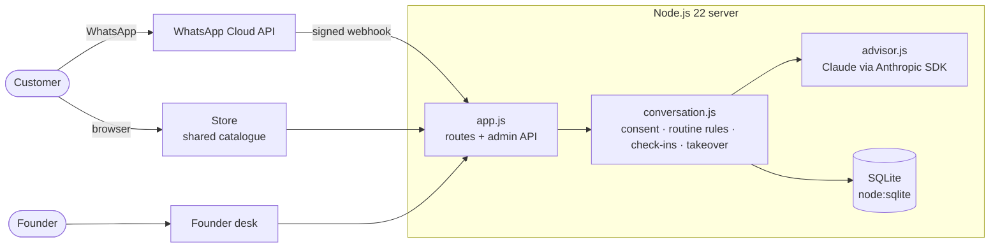

# OneSkin Botanica: case study

**A skincare store for deeper skin in South Africa, and "Naledi", an AI skin advisor that works over WhatsApp.**

Source code: private, walkthrough available on request · Pre-launch · 2026

---

## What it is

One small Node.js server runs three things:

| Part | What it does |
|---|---|
| **The store** | The product catalogue and a skin consultation in the browser. A setting switches it to a holding page until launch. |
| **Naledi (WhatsApp)** | An AI skin advisor. It asks for consent, asks five questions, recommends a routine of four products or fewer, then checks in at weeks 2, 4 and 8. |
| **Founder desk** | An admin dashboard: every conversation, flags, and the option to take over a chat from the AI. |

## Architecture

## Engineering decisions

**Rules live in code, not only in the prompt.** A language model can be talked out of its instructions, so the important rules are enforced by the server:
- A routine has at most four products.
- Naledi can only recommend a product that is actually in stock.
- Nothing is stored before the customer gives consent.
- The browser can't send its own system prompt, so the API can't be abused as a free chatbot.

**Safe by design.** Messages arriving from WhatsApp must pass a signature check. Customers can send STOP or DELETE at any time. Check-ins go out at 10:00 South African time, never at night, and use approved templates outside WhatsApp's 24-hour window. Naledi refers serious conditions such as cystic acne to a professional and declines requests for skin lightening.

**Runs with zero setup.** With no API keys, Naledi runs as a scripted development stub and WhatsApp runs in dry-run mode, so replies go to an outbox and the admin desk instead of a real phone. Anyone can clone it and try the full flow safely.

**Launch phases are settings, not code.** `STORE_PUBLIC`, `CHECKOUT_OPEN` and `AVAILABLE_PRODUCTS` move the business through its launch plan without a redeploy. The store also supports English, isiXhosa and Sesotho.

**Deployment that matches the design.** It is packaged with Docker and runs as one always-on machine in the Johannesburg region. It is one machine on purpose: the database is a file on that disk and the check-in scheduler runs inside the process, so two machines would mean two databases.

## Quality

- **19 automated tests** (Node's built-in test runner) against the stub and an in-memory database. They cover consent, the full consultation, the four-product cap, no unavailable products, check-in timing, STOP and DELETE, founder takeover, webhook signatures and the store staying offline.
- **Live smoke tests** against the real model play three customers: one with dark marks, one with cystic acne (must be referred out) and one asking for lightening (must be declined). A second smoke test checks every supported language.

## Stack

| Area | Tools |
|---|---|
| Server | Node.js 22 with no framework, built-in `node:sqlite` |
| AI | Claude through the official Anthropic SDK, with refusal fallbacks |
| Messaging | WhatsApp Cloud API (webhooks, templates) |
| Front end | HTML, React (no build step) |
| Testing | `node:test`, live smoke tests |
| Deployment | Docker, Fly.io (Johannesburg), Vercel |

## What I learned

- Never trust a prompt to enforce a business rule: check it in code.
- Design the safe path first: consent, opt-out and referrals before features.
- Make the app runnable with no secrets, so testing never needs real customers or real money.

---

Thabiso Motsitsi · [inkmastersonline@gmail.com](mailto:inkmastersonline@gmail.com) · [GitHub profile](https://github.com/inkmastersonline-cmd)
